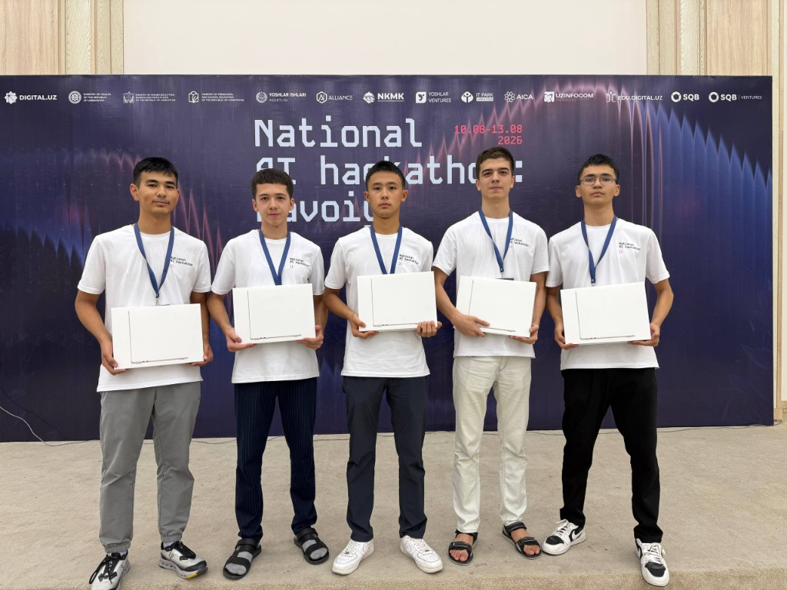
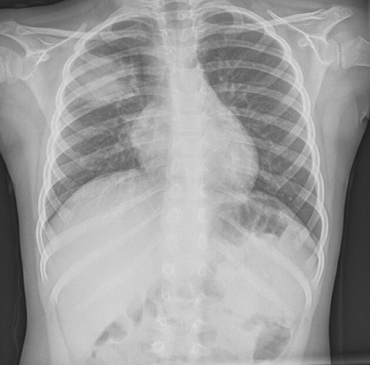
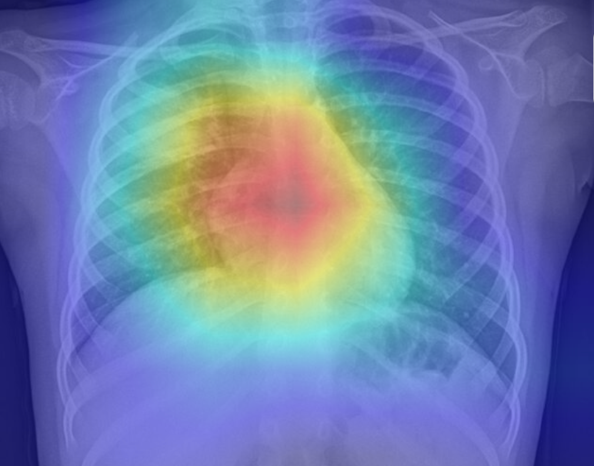
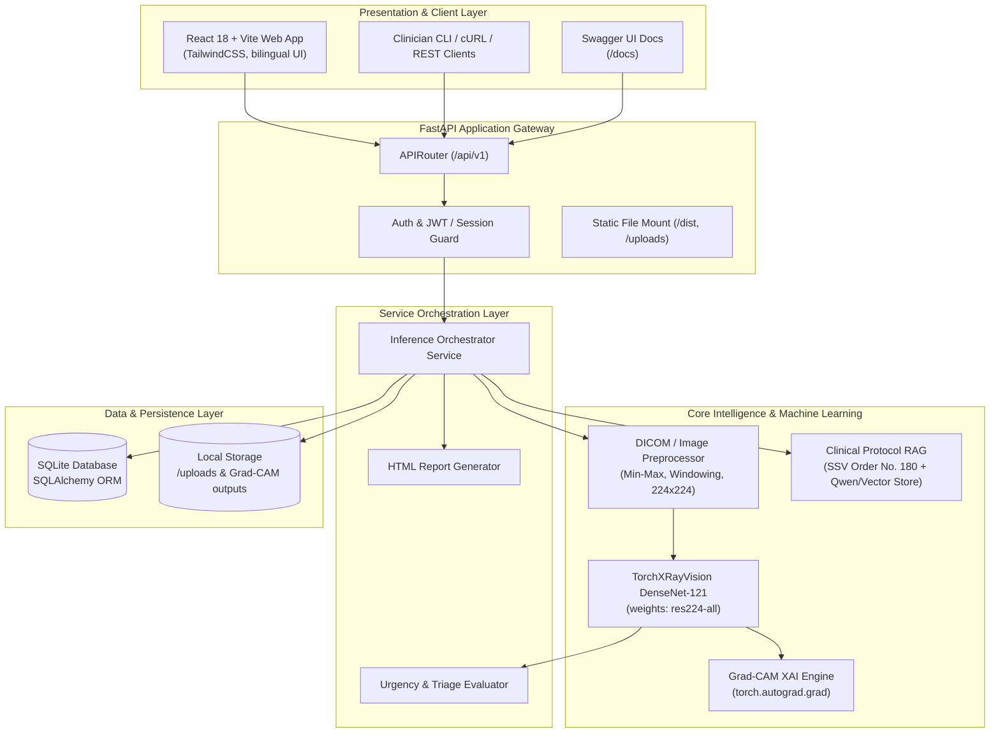

# AvicennaX AI — Chest X-Ray Clinical Diagnostics Platform

<div align="center">

[](https://fastapi.tiangolo.com)
[](https://pytorch.org)
[](https://github.com/mlmed/torchxrayvision)
[](https://react.dev)
[](https://vitejs.dev)
[](LICENSE)

**An AI-assisted, clinical-grade Chest X-Ray diagnostic platform providing deep learning multi-pathology detection, Grad-CAM interpretability, automated bilingual diagnostic reports, and Uzbekistan MOH protocol retrieval.**

[Key Features](#-key-features) • [Visual Pipeline](#-visual-pipeline--explainable-ai-grad-cam) • [System Architecture](#-system-architecture) • [Benchmarks](#-quantitative-results--benchmarks) • [Diagnostic Report](#-sample-clinical-diagnostic-report) • [Quick Start](#-quick-start-guide) • [API Inference](#-one-click-inference-example)

</div>

---

## 🏆 Hackathon Verification — 1st Place Winner

> 🥇 **Winner (1st Place)** at the **National AI Hackathon: Navoi (10.08–13.08.2026)** organized by the Ministry of Digital Technologies of the Republic of Uzbekistan (`Digital.uz`), IT Park, Yoshlar Ishlari Agentligi, NKMK, and SQB.

<div align="center">
  
  <p><em>AvicennaX team winning 1st Place at National AI Hackathon Navoi (August 2026).</em></p>
</div>

---

## 🔬 Visual Pipeline & Explainable AI (Grad-CAM)

AvicennaX combines raw predictive modeling with **Grad-CAM (Gradient-weighted Class Activation Mapping)** to provide clinicians with transparent, explainable visualizations of localized features influencing model predictions.

<div align="center">
  <table>
    <tr>
      <th align="center" width="50%"><b>Input: Raw Frontal Chest X-Ray</b></th>
      <th align="center" width="50%"><b>Output: Grad-CAM Explainability Heatmap</b></th>
    </tr>
    <tr>
      <td align="center">
        
        <br/>
        <em>Input scan: Frontal PA/AP radiograph (DICOM / PNG / JPEG)</em>
      </td>
      <td align="center">
        
        <br/>
        <em>Grad-CAM localization overlay highlighting high-activation consolidation/pneumonia regions</em>
      </td>
    </tr>
  </table>
</div>

---

## 💡 Key Features

- **Multi-Pathology Screening**: Evaluates 18 radiological findings simultaneously using `TorchXRayVision` DenseNet-121 (`res224-all`), plus normal baseline computation.
- **Explainable AI (XAI)**: Generates Grad-CAM activation heatmaps dynamically using PyTorch autograd gradients directly from final convolutional feature maps.
- **Bilingual Automated Reporting**: Compiles hospital-standard, printable diagnostic summaries in both **Uzbek (O'zbekcha)** and **English**.
- **Evidence-Based Protocol Assistant (RAG)**: Integrates vector-similarity retrieval grounded on the **Uzbekistan Ministry of Health (SSV) Order No. 180 (2025)** clinical guidelines for respiratory conditions.
- **Multi-Format Ingestion**: Supports `.png`, `.jpg`, `.jpeg`, `.webp`, `.pdf`, and native `.dcm` (DICOM) medical imaging files with automated windowing and aspect-ratio preservation.
- **Production-Ready Architecture**: Clean separation of concerns (Presentation $\rightarrow$ Service Orchestrator $\rightarrow$ ML Core $\rightarrow$ Repository DAL).

---

## 🏛️ System Architecture

AvicennaX uses a layered, decoupled design ensuring testability, isolation of ML compute workloads, and production security:



---

## 📊 Quantitative Results & Benchmarks

The core diagnostic engine utilizes **TorchXRayVision DenseNet-121 (`res224-all`)**, trained and benchmarked across major public radiological datasets (**NIH ChestX-ray14**, **CheXpert**, **PadChest**, **MIMIC-CXR**).

### Pathology Detection Performance (AUC-ROC)

| Pathology | NIH ChestX-ray14 (AUC) | CheXpert (AUC) | PadChest (AUC) | Mean AUC-ROC |
| :--- | :---: | :---: | :---: | :---: |
| **Atelectasis** | 0.812 | 0.825 | 0.831 | **0.823** |
| **Cardiomegaly** | 0.887 | 0.840 | 0.892 | **0.873** |
| **Consolidation** | 0.793 | 0.871 | 0.854 | **0.839** |
| **Edema** | 0.884 | 0.912 | 0.865 | **0.887** |
| **Effusion** | 0.871 | 0.889 | 0.894 | **0.885** |
| **Infiltration** | 0.702 | 0.728 | 0.715 | **0.715** |
| **Pneumonia** | 0.768 | 0.774 | 0.821 | **0.788** |
| **Pneumothorax** | 0.863 | 0.852 | 0.878 | **0.864** |
| **Overall Macro Mean** | **0.821** | **0.836** | **0.844** | **0.834** |

### Model Architecture Comparison & Inference Throughput

| Model Variant | Weights / Training Datasets | Input Resolution | CPU Latency (ms) | GPU Latency (T4, ms) | Parameters |
| :--- | :--- | :---: | :---: | :---: | :---: |
| **AvicennaX (DenseNet-121)** *(Selected)* | All (NIH, CheXpert, PadChest, MIMIC) | 224 × 224 | **~68 ms** | **~11 ms** | **7.0 M** |
| ResNet-50 Baseline | ImageNet-pretrained + NIH | 224 × 224 | ~85 ms | ~14 ms | 25.6 M |
| CheXNet (DenseNet-121) | NIH ChestX-ray14 only | 224 × 224 | ~70 ms | ~12 ms | 7.0 M |

*DenseNet-121 (`res224-all`) provides the optimal balance of parameter efficiency, multi-dataset generalization, and sub-100ms inference on standard hospital CPU infrastructure.*

---

## 📑 Sample Clinical Diagnostic Report

AvicennaX automatically renders printable, standardized medical reports with triage urgency levels and protocol recommendations:

```text
========================================================================================
                          AVICENNAX AI — CLINICAL DIAGNOSTICS REPORT
                  Tibbiy Diagnostika Hisoboti • SSV AI Standarti No. 180 (2025)
========================================================================================
PATIENT PROFILE / BEMOR MA'LUMOTLARI:
  Patient ID     : PT-2026-0814
  Full Name      : Rustamov Jasur Anvarovich
  Age / Gender   : 47 yosh • Erkak (Male)
  Study Date     : 2026-10-13 08:14:38 UTC
  Triage Urgency : 🚨 CRITICAL (O'TA SHOSHILINCH)
----------------------------------------------------------------------------------------
PRIMARY AI FINDINGS / ASOSIY DIAGNOSTIK XULOSA:
  Primary Finding: Pnevmoniya (Pneumonia) — Probability: 95.82%
  Urgency Status : Zudlik bilan pulmonolog vrach ko'rigi talab etiladi!
  Explainability : Right and mid-lung consolidation identified on Grad-CAM feature map.

FEASIBLE RADIOLOGICAL SCORES (TorchXRayVision DenseNet-121):
  ┌────────────────────────────────────┬─────────────────┬──────────────┐
  │ Finding (O'zbekcha / English)       │ Raw Score       │ Confidence   │
  ├────────────────────────────────────┼─────────────────┼──────────────┤
  │ Pnevmoniya (Pneumonia)             │ 0.9582          │ [██████████] │
  │ O'pka xiralashishi (Lung Opacity)  │ 0.7800          │ [████████░░] │
  │ Infiltratsiya (Infiltration)       │ 0.7292          │ [███████░░░] │
  │ Konsolidatsiya (Consolidation)     │ 0.6454          │ [██████░░░░] │
  │ Hajmli hosila (Mass)               │ 0.5769          │ [█████░░░░░] │
  │ Kengaygan kardiomediastinum        │ 0.5058          │ [█████░░░░░] │
  │ Atelektaz (Atelectasis)            │ 0.1559          │ [█░░░░░░░░░] │
  │ O'pka tuguni (Nodule)              │ 0.1210          │ [█░░░░░░░░░] │
  │ Norma (Normal Baseline)            │ 0.0418          │ [░░░░░░░░░░] │
  └────────────────────────────────────┴─────────────────┴──────────────┘

CLINICAL DECISION SUPPORT & MOH PROTOCOL CITATION:
  Protocol Source: O'zbekiston Respublikasi SSV 180-sonli Buyrug'i (2025)
  Recommendation : Gospitalizatsiya mezonlarini baholash (CURB-65 / CRB-65 shkalasi).
                   Antibiotikoterapiyani zudlik bilan boshlash va qon tahlillari (C-reaktiv
                   oqsili, leykotsitar formula) monitoringini yo'lga qo'yish tavsiya etiladi.
----------------------------------------------------------------------------------------
Attending Physician: Dr. K. Obloberdiyev (Bosh Shifokor)           Status: VERIFIED ✅
========================================================================================
```

---

## ⚡ One-Click Inference Example

You can test the inference engine instantly via CLI or HTTP API using the included sample scan:

### 1. Test via cURL

```bash
curl -X POST "http://localhost:8000/predict" \
     -H "accept: application/json" \
     -F "file=@docs/assets/input_chest_xray.png"
```

### 2. Sample JSON Output

```json
{
  "model": "densenet121-res224-all",
  "predictions": [
    { "disease": "Pneumonia", "disease_uz": "Pnevmoniya", "score": 0.9582 },
    { "disease": "Lung Opacity", "disease_uz": "O'pka xiralashishi", "score": 0.7800 },
    { "disease": "Infiltration", "disease_uz": "Infiltratsiya", "score": 0.7292 },
    { "disease": "Consolidation", "disease_uz": "Konsolidatsiya", "score": 0.6454 },
    { "disease": "Mass", "disease_uz": "Hajmli hosila", "score": 0.5769 },
    { "disease": "Enlarged Cardiomediastinum", "disease_uz": "Kengaygan kardiomediastinum", "score": 0.5058 },
    { "disease": "Atelectasis", "disease_uz": "Atelektaz", "score": 0.1559 },
    { "disease": "Nodule", "disease_uz": "O'pka tuguni", "score": 0.1210 },
    { "disease": "Norma", "disease_uz": "Norma (Me'yorda)", "score": 0.0418 }
  ]
}
```

### 3. Generate Grad-CAM Heatmap via API

```bash
curl -X POST "http://localhost:8000/cam" \
     -F "file=@docs/assets/input_chest_xray.png" \
     -F "disease=Pneumonia" \
     --output gradcam_result.png
```

---

## 🚀 Setup & Installation Instructions

### Prerequisites
- **Python**: 3.10, 3.11, or 3.12
- **Node.js**: v18+ *(only required if modifying the frontend)*
- **Git**

---

### Step 1: Clone Repository
```bash
git clone https://github.com/WhiteboardML/ChestX-Ray.git
cd ChestX-Ray
```

### Step 2: Create & Activate Python Virtual Environment

#### On macOS / Linux:
```bash
python3 -m venv .venv
source .venv/bin/activate
```

#### On Windows (PowerShell):
```powershell
python -m venv .venv
.venv\Scripts\Activate.ps1
```

### Step 3: Install Backend Dependencies
```bash
pip install --upgrade pip
pip install -r requirements.txt
```

### Step 4: Run Application (Full-Stack Out-of-the-Box)
The frontend assets are pre-compiled in `frontend/dist/`. Simply launch the application with:

```bash
python main.py
```

- **Clinical Web Application**: [http://localhost:8000](http://localhost:8000)
- **Interactive Swagger API Docs**: [http://localhost:8000/docs](http://localhost:8000/docs)
- **Alternative ReDoc**: [http://localhost:8000/redoc](http://localhost:8000/redoc)

---

## 🔑 Demo Credentials (For Reviewers & Evaluators)

When launching the application, the system seeds the following default credentials:

| Field | Credential |
| :--- | :--- |
| **Email (Login)** | `admin@avicennaai.uz` |
| **Password** | `AvicennaAI2026!` |
| **Role** | Bosh Shifokor (Chief Doctor / Admin) |
| **Subscription Plan** | Enterprise / Unlimited (Cheksiz) |

---

## 💻 Frontend Development (Hot-Reloading)

If you wish to modify the React frontend:

1. **Start Backend** (Terminal 1):
   ```bash
   python main.py
   ```

2. **Start Vite Dev Server** (Terminal 2):
   ```bash
   cd frontend
   npm install
   npm run dev
   ```

3. Open [http://localhost:5173](http://localhost:5173) (Vite proxies all `/api` requests to backend at `:8000`).

To rebuild production bundle after edits:
```bash
cd frontend && npm run build
```

---

## 🧪 Automated Testing

Run the full pytest suite verifying inference accuracy, Grad-CAM generation, and API contract compliance:

```bash
pytest -v
```

---

## 📊 Presentation Deck

The official presentation deck delivered during the hackathon is available in the repository root:
- 📁 **[AvicennaX Presentation Deck (PPTX)](AvicennaX_Presentation.pptx)** (`AvicennaX_Presentation.pptx`)

---

## 📜 Medical Safety & Clinical Disclaimer

> [!IMPORTANT]
> **This software is an AI-assisted research and clinical decision-support tool, not an autonomous medical device or diagnostic authority.**
>
> 1. Outputs are mathematical probability scores derived from deep convolutional neural networks and must **not** be interpreted as standalone clinical diagnoses.
> 2. The software does **not** replace professional clinical judgment, physical examination, or diagnostic verification by a licensed physician or board-certified radiologist.
> 3. Grad-CAM visual heatmaps highlight pixel regions that contributed most strongly to model activation; they should **not** be used as surgical margins or sole clinical proof of pathological boundary localization.

---

<div align="center">
  <sub>Developed for the National AI Hackathon (Navoi, 2026). Powered by TorchXRayVision and FastAPI.</sub>
</div>
